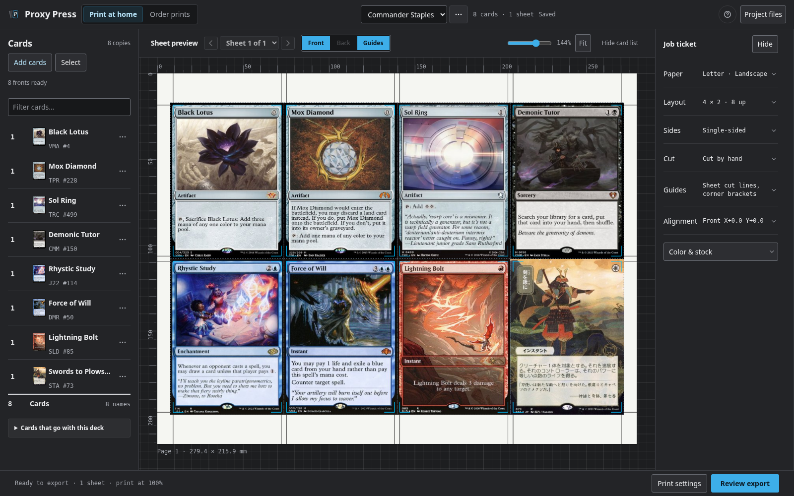

# Proxy Press

Make Magic: The Gathering proxies from a decklist. Choose artwork, lay out sheets for your printer, or prepare an order for MakePlayingCards.



## Install

Open the [latest release](https://github.com/zoro11031/proxypress/releases/latest) and expand **Assets**.

- **Windows x64:** Run the `.exe` installer or the `.msi` package.
- **Linux x86-64:** Use the AppImage, or choose `.deb` for Debian and Ubuntu, `.rpm` for Fedora and openSUSE, or `.pacman` for Arch. Mark the AppImage executable before launching it.

### Docker

Clone the repository and run `docker compose up -d`. Open `http://localhost:8642` on the server. To reach it from another device, set the server’s LAN address in `PROXY_PRESS_BIND` in `.env`. See [`.env.example`](.env.example) for the password and sharing settings.

To update a local checkout, run:

```sh
git pull --ff-only
docker compose up -d --build
```

## Add cards

Paste a decklist, import a Moxfield or Archidekt link, or upload images. Choose **Change art** from a card’s menu to browse printings or community artwork. **Create a card** lets you add your own artwork to a card frame.

## Print at home

Choose your paper and card layout in **Print Settings**. Check both sides in the sheet preview, then open **Review export** to download all sheets or pick one to reprint. Print at **Actual size / 100%**. If the backs sit off-center, use **Alignment → Align front and back**.

### Silhouette cutters

In **Print Settings → Cutting**, select **Silhouette cutter** and choose your paper size. **Silhouette Card Maker** matches the stock template for the selected paper and card size, including Letter and A4 for standard Magic cards. Borderless is available where a matching template exists. With these templates, use long-edge flip for double-sided printing.

The Silhouette Card Maker layout automatically turns off printed guides, uses 0.625 mm bleed, and takes the registration inset from the selected template (10 mm for standard Letter and A4). The stock template also fixes where each card lands on the page. For a custom layout, use the PDF and cut files from the same export. [Silhouette Card Maker cutting guide](https://alan-cha.github.io/silhouette-card-maker/tutorial/guide/)

Download the **print & cut ZIP** from **Review export**. It includes the PDF and matching cut files for each sheet. In [Silhouette Control Center](https://github.com/zoro11031/silhouette-cameo-linux), open the ZIP under **Sheet**. In Silhouette Studio, open the Studio file when available or use DXF with the settings under **Cut instructions**.

### Foil colors

In **Print Settings → Color**, choose **Foil colors** and print a test sheet on your foil paper. If the result looks dark or muted, adjust brightness, saturation, or contrast. Choose **Save as foil default** to reuse those colors across decks when you select a foil preset.

## Order prints

Choose **Order prints → Review order**. Pick cardstock and a shared cardback, then download the order ZIP. Open **How to place the order** for the desktop tool and upload steps.

## Backups and sharing

Decks save in your browser. Use **Project files** to save a backup or **Share or save a deck copy** in review to export a single deck with artwork.

On a self-hosted instance, you can create a share link. Anyone with the link can open the shared copy. Match an uploaded image to a card if you want to make that artwork searchable by others on the same server.

## Credits and license

Thanks to [MPC Autofill](https://mpcfill.com), [Scryfall](https://scryfall.com), [EDHREC](https://edhrec.com), and [Silhouette Card Maker](https://github.com/Alan-Cha/silhouette-card-maker). You can [support MPC Autofill on Patreon](https://www.patreon.com/mpcfill).

Proxy Press is licensed under [GPL-3.0-or-later](LICENSE). Card art, fonts, frames, and trademarks belong to their respective owners and are subject to their own rights.
