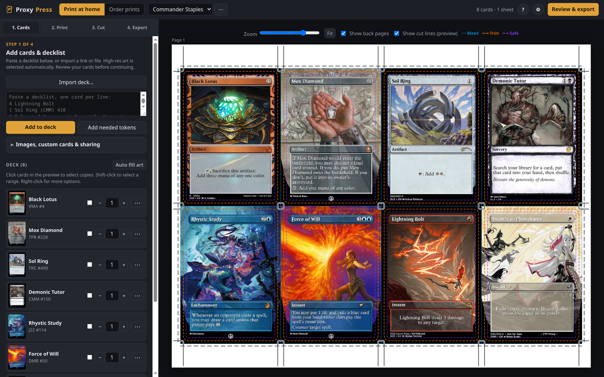
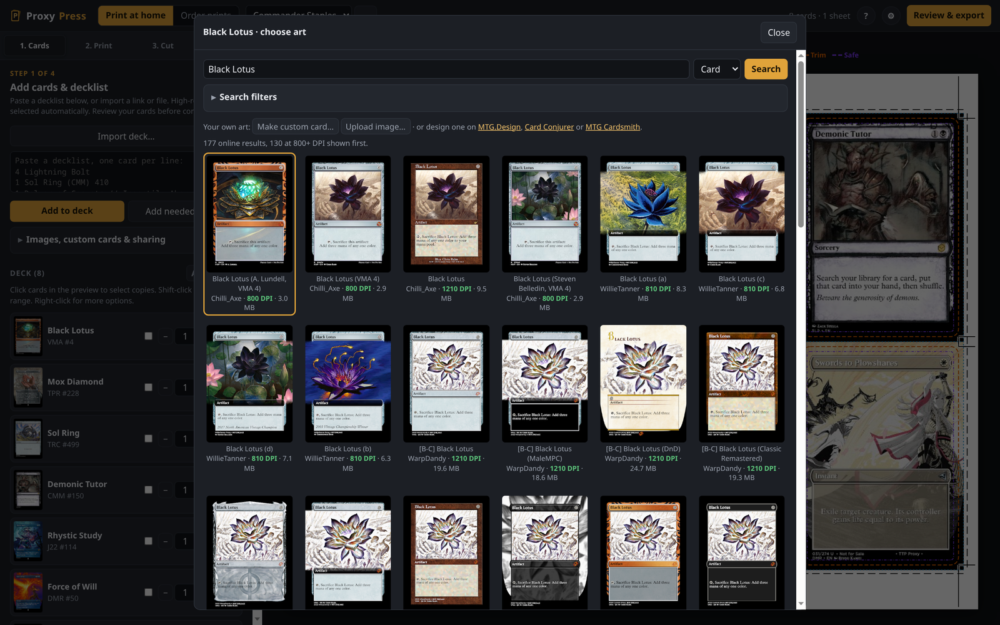
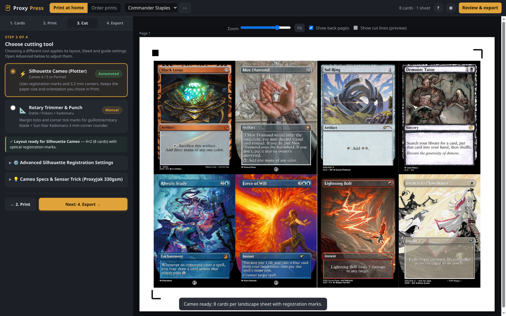
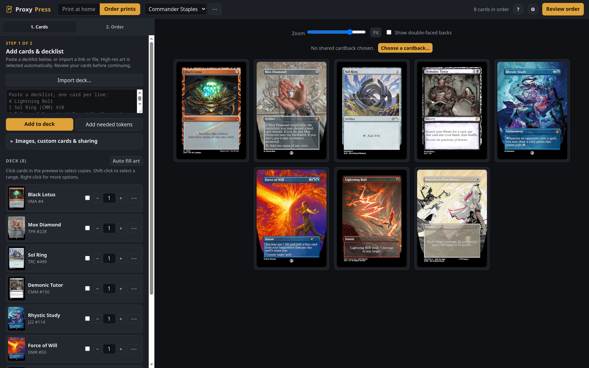

# Proxy Press

A browser-based MTG proxy maker. Drop in a decklist, pick your art, and get a print-ready PDF with proper bleed and cut lines—or an order file ready for MakePlayingCards.

Runs entirely in your browser with zero accounts or tracking. Decks, presets, and artwork stay securely saved on your own machine.



---

## Running Proxy Press

### 🐳 Docker / Podman (Recommended & Supported)

Running with Docker or Podman is the officially supported, easiest way to host Proxy Press. It isolates the environment, persists your card cache, and serves all bundled fonts and card frame packs automatically.

```sh
cp .env.example .env    # optional: configure password, port, etc.
docker compose up -d    # or: podman compose up -d
```

Then open http://localhost:8642 in your browser.

#### Configuration options

| Variable | Default | Purpose |
|---|---|---|
| `PASSWORD` | — | Optional password for the web login screen (`PROXY_PRESS_PASSWORD` in `.env`) |
| `BASIC_AUTH` | — | Optional `user:password` browser login prompt (`PROXY_PRESS_AUTH` in `.env`) |
| `ASSETS` | `./assets` | Folder of fonts and frame packs (`/app/assets` in container) |
| `CACHE` | `./cache` | Folder for cached Scryfall card data and session key (`/app/cache` in container) |
| `HOST` | `127.0.0.1` (`0.0.0.0` in container) | Interface to listen on (`PROXY_PRESS_BIND` in `.env`) |
| `PORT` | `8642` | Port (`PROXY_PRESS_PORT` in `.env`) |

---

### 💻 Desktop App (Windows & Linux)

If you prefer a standalone desktop app without Docker, prebuilt Electron packages with all fonts and frames bundled are available under [Releases](https://github.com/zoro11031/proxypress/releases):

- **Windows:** Download and run the installer (`ProxyPress-Setup-*.exe` or `ProxyPress-*.msi`).
- **Linux:** Download `ProxyPress-*.AppImage`, make it executable (`chmod +x ProxyPress-*.AppImage`), and double-click to launch.

Both desktop packages run locally with an embedded relay for MPC Autofill and Scryfall caching.

---

### ⚙️ Advanced & Alternative Setups

#### Run with Python directly
```sh
python3 proxy-press-server.py
```
Starts the local server and opens http://localhost:8642 in your default browser. Requires Python 3.10+ (standard library only, no pip dependencies).

#### Serverless / Offline (Browser Only)
You can also double-click `proxy-press.html` directly in any modern browser. Everything works offline except searching community art drives (which requires the Docker container, desktop app, or Python script due to external site CORS restrictions).

---

## What it does

### Quick deck imports
Paste a decklist or import a link from Moxfield or Archidekt (MTG Arena and MTGO text exports work too). It can also add all the tokens and emblems your deck needs with one click. If you want to send a deck to a friend, export a deck package with the artwork included—when they open it, their own printer settings and alignment stay untouched.

### High-res art search
High-res art is matched automatically using Scryfall and community autofill drives. If you want a specific printing, retro border, or borderless version, click any card to browse alternate arts and high-DPI renders. You can also make custom cards or point it to a folder of card images on your computer.



### Print at home or order online

- **Home printing:** Generates clean PDFs for standard Letter or A4 sheets. It builds bleed edge extensions so cards don't have white edges when cut, and lets you dial in front-to-back alignment for two-sided prints. Built-in cut guides support both hand trimmers (margin and corner marks) and automated craft plotters like the Silhouette Cameo (registration marks and cut SVGs).
- **Ordering prints:** Switch to Order mode to review your card fronts and backs in a gallery, then download an XML order file and images ready for the autofill desktop tool.





---

## Card maker assets (fonts & frames)

Proxy Press includes an in-browser Custom Card Maker for designing custom cards, tokens, and proxies with authentic Magic typography and layouts.

All essential fonts and frame packages come pre-bundled in `assets/`:

```
assets/
├── fonts/
│   ├── Beleren2016-Bold.ttf          # Modern card title
│   ├── Beleren Small Caps.ttf        # Modern type line & P/T
│   ├── PlantinMTProRg.TTF            # Rules text (regular)
│   ├── PlantinMTProRgIt.TTF          # Flavor & reminder text (italic)
│   ├── PlantinMTProBold.TTF          # Bold rules & P/T numbers
│   ├── Magicmedieval-pRV1.ttf        # Retro card title
│   ├── Matrix Bold.ttf               # Retro type line & 8th Edition frames
│   ├── Relay-Medium.ttf              # Collector line & copyright
│   └── ModMatrix.ttf                 # Modern P/T font
└── frames/
    ├── magic-m15.mse-style/          # Modern frame (2014–present)
    ├── magic-m15-planeswalker.mse-style/
    ├── magic-new.mse-style/          # Modern frame (2003–2014)
    ├── magic-old.mse-style/          # Classic retro frame (1993–2003)
    └── ...                           # Other .mse-style packages
```

### Fonts

Proxy Press automatically inspects filenames in `assets/fonts/` and assigns them to the appropriate typography slot:

| Slot | Font | Recognized filenames |
|---|---|---|
| Modern Name | Beleren Bold | `Beleren2016-Bold.ttf`, `Beleren-Bold.ttf`, `beleren-bold_P1.01.ttf` |
| Modern Type & P/T | Beleren Small Caps | `Beleren Small Caps.ttf`, `belerensmallcaps-bold.ttf` |
| Rules Text | Plantin Regular | `PlantinMTProRg.TTF`, `mplantin.ttf`, `Plantin.ttf` |
| Flavor / Reminder | Plantin Italic | `PlantinMTProRgIt.TTF`, `mplantinit.ttf` |
| Bold Text | Plantin Bold | `PlantinMTProBold.TTF` |
| Retro Name | Magic Medieval | `Magicmedieval-pRV1.ttf`, `MAGIC.TTF`, `magmed.ttf` |
| Retro Type / 8th Ed | Matrix Bold | `Matrix Bold.ttf`, `MatrixBold.ttf`, `matrixb.ttf` |
| Collector Line | Relay Medium / Gotham | `Relay-Medium.ttf`, `Gotham Medium.otf` |
| Future Sight | Eurostile / Futura | `Eurostile.ttf`, `Microgramma.ttf`, `Futura.ttf` |
| Matrix P/T | ModMatrix | `ModMatrix.ttf` |

*Mana symbols and loyalty icons don't need font files—they are fetched as SVGs directly from Scryfall and cached.*

### Frames

Proxy Press reads standard Magic Set Editor (`.mse-style`) frame packages directly from `assets/frames/`. Supported frame directories include modern M15, Planeswalker, 8th Edition, classic retro, borderless extended art, and vintage ABU frames.

You can also drop font files and `.mse-style` folders straight onto the Custom Card Maker tab in the browser without touching server folders. They get stored directly in IndexedDB.

---

## Helpful tips

- **Selecting cards:** In the sheet preview, click a card copy to select it, Shift-click for a range, or Ctrl/Cmd-click to toggle copies. On a phone or tablet, tap copies to toggle them.
- **Batch art changes:** Select copies, then click **Change selected art…** to swap art across all of them at once.
- **Print scale:** When printing the exported PDF, always make sure printer scaling is set to **100% / Actual Size** (not "Fit to page" or "Shrink to fit"). Otherwise, cards won't come out at standard Magic dimensions (63 × 88 mm).
- **Silhouette Cameo cutting:** Export the cut SVG, import it at 100% scale in Silhouette Studio, and make sure registration marks are enabled.
- **Backups & resets:** Everything is stored in your browser's IndexedDB. Use **⚙ (top right) → Save backup file…** to move your decks between machines. Use **⚙ → Return to defaults** if you ever want to reset print and preview settings while keeping your saved decks and artwork.

---

## Special thanks

Huge thanks to **[MPC Autofill / MPCFill](https://mpcfill.com)** above all. None of this would exist without their database, community drives, and the artists creating and sharing high-DPI card renders.

Also big thanks to:

- **[ProxyJak](https://proxyjak.com)** — For providing an easy way to get quality proxy cardstock.
- **[Cry Cry](https://www.youtube.com/@crycryproxy)** — The best proxy tutorials on YouTube for paper choices, printer settings, foiling, and cutter setup.
- **[Scryfall](https://scryfall.com)** — The card data and image API that powers the entire MTG community.
- **[Proxxied](https://proxxied.com)** — Great inspiration for in-browser sheet layouts and card grids.
- **[Magic Set Editor](https://magicseteditor.boards.net)** — Frame layouts, fonts, and templating conventions.
- **Card Conjurer & MTG.Design** — Pioneers of web-based card rendering.
- **r/mpcproxies & r/magicproxies** — Endless tips on paper stocks, calibration, and proxy crafting.

---

## License & Fair Use Notice

Proxy Press code is free software licensed under the [GNU General Public License v3.0](LICENSE) (GPL-3.0-or-later).

**Typography & Card Asset Fair Use Notice:** Card frames, symbol vectors, and font files bundled in `assets/` (such as Beleren, Plantin, and Magic Medieval) are proprietary trademarks and copyrights of their respective owners (including Wizards of the Coast and Monotype). They are not covered under the GNU General Public License v3.0 and are bundled in accordance with fair use for non-commercial, personal card crafting and proxy printing.
