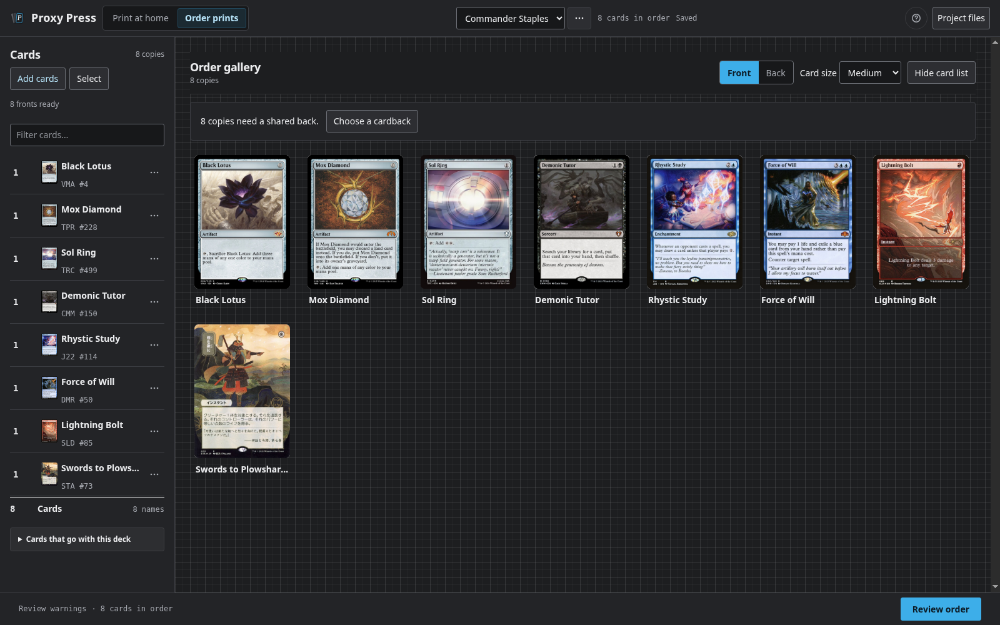

# Proxy Press

Make Magic: The Gathering proxies from a decklist. Pick artwork, print sheets at home, or prepare an order for MakePlayingCards.


## Install

**Desktop:** download the Windows (`.exe`, `.msi`) or Linux (AppImage, `.deb`, `.rpm`, `.pacman`) package from the [latest release](https://github.com/zoro11031/proxypress/releases/latest). Mark the AppImage executable before running it.

**Docker:** clone the repository and run `docker compose up -d`, then open `http://localhost:8642`. To use it from other devices, set `PROXY_PRESS_BIND` in `.env` to the server's LAN address. [`.env.example`](.env.example) lists the password and sharing options. To update:

```sh
git pull --ff-only
docker compose up -d --build
```

## Add cards

Choose **Add cards** to paste a decklist, import a Moxfield or Archidekt link, or upload images. To swap artwork, choose **Change art** from a card's menu and pick a printing or community art. **Create a card** puts your own art in a card frame.


## Print at home

1. Set paper, layout and sides in **Print settings**, and check both sides in the sheet preview.
2. Choose **Review export** and download the PDF.
3. Print at **Actual size / 100%**.

If the backs are off-centre, use **Alignment → Align front and back**. Its double-sided test prints your real layout on both sides with five pin points on every card. Push a pin through each point from the front and read where the hole lands on the 1 mm grid behind it, or scan page 2 against black paper and let Proxy Press read every hole. One point corrects the back's offset; points on cards far apart also correct its angle and size. The front is never changed.

### Silhouette cutters

In **Print settings → Cutting**, choose **Silhouette cutter** and your paper size. The **Silhouette Card Maker** templates match Card Maker's own output: card positions, bleed, registration marks and the sheet label, checked against its `create_pdf.py` on all 190 templates. It turns printed guides off and sets the bleed and registration marks for you. For double-sided sheets, flip on the long edge.

Download the **print & cut ZIP** from **Review export**. It contains the PDF and matching cut files for each sheet. Always cut with the files from the same export. In [Silhouette Control Center](https://github.com/zoro11031/silhouette-cameo-linux), open the ZIP under **Sheet**. In Silhouette Studio, open the Studio file or the DXF; **Cut instructions** has the settings. See also the [Silhouette Card Maker guide](https://alan-cha.github.io/silhouette-card-maker/tutorial/guide/).


### Foil colors

In **Print settings → Color**, choose **Foil colors** and print a test sheet on your foil paper. If it comes out dark or muted, raise brightness, saturation or contrast. **Save as foil default** reuses those settings for every foil preset.

## Order prints

Switch to **Order prints** and choose **Review order**. Pick a cardstock and a shared cardback, then download the order ZIP. **How to place the order** walks through the upload.



## Backups and sharing

Decks are saved in your browser. **Project files** saves a backup of everything. **Share or save a deck copy** exports one deck with its artwork.

On a self-hosted server you can also **Create share link**, and anyone with the link can open that copy. Artwork you upload and match to a card becomes searchable for other users on the same server.

## Credits and license

Thanks to [MPC Autofill](https://mpcfill.com) ([Patreon](https://www.patreon.com/mpcfill)), [Scryfall](https://scryfall.com), [EDHREC](https://edhrec.com) and [Silhouette Card Maker](https://github.com/Alan-Cha/silhouette-card-maker).

Licensed under [GPL-3.0-or-later](LICENSE). Card art, fonts, frames and trademarks belong to their owners.
