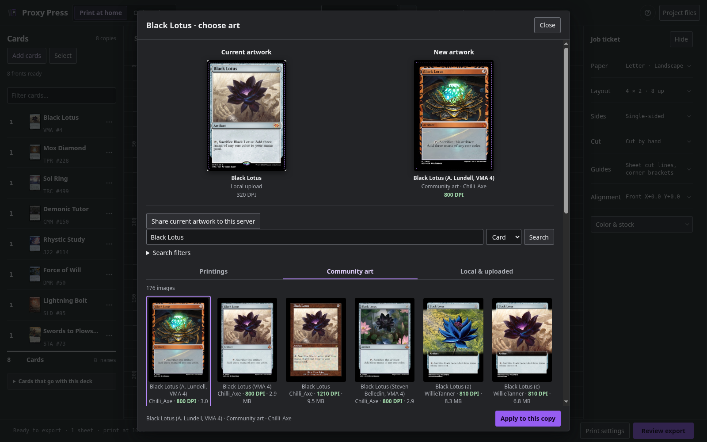
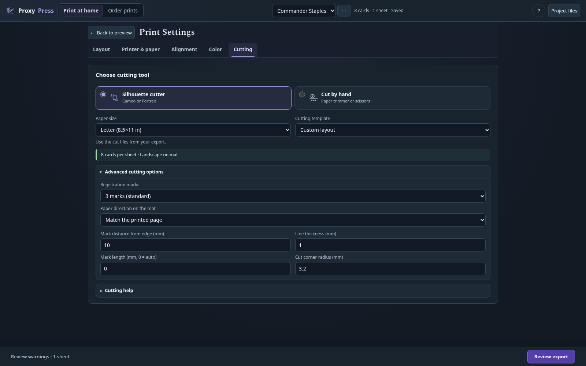

# Proxy Press

A free, easy MTG proxy maker. Paste your decklist, choose your favorite art, and get a print-ready PDF with proper cut lines—or an order file ready for MakePlayingCards.

No accounts, no tracking, and no subscriptions. Everything runs directly on your machine.


---

## Which download is best for you?

### 💻 For Normal Users (Easiest & Recommended)

Download the desktop app from **[Releases](https://github.com/zoro11031/proxypress/releases)**:

- **Windows:** Download and run `Proxy-Press-0.8.0.exe` (or `Proxy-Press-0.8.0.msi`).
- **Linux:** Download `Proxy-Press-0.8.0.AppImage`, make it executable (`chmod +x Proxy-Press-0.8.0.AppImage`), and double-click to launch.

*No setup required. All authentic MTG fonts, card frames, and high-res art search tools are built in with no login or password needed.*

#### Other Linux packages (optional)
If you prefer installing via your distribution's package manager:
- **Debian / Ubuntu (.deb):** `sudo apt install ./Proxy-Press-0.8.0.deb`
- **Fedora / openSUSE / RHEL (.rpm):** `sudo dnf install ./Proxy-Press-0.8.0.rpm` (or `sudo zypper install ./Proxy-Press-0.8.0.rpm`)
- **Arch / CachyOS / Manjaro (.pacman):** `sudo pacman -U Proxy-Press-0.8.0.pacman` (or unpack `proxypress-bin-aur.tar.gz` and run `makepkg -si`)

---

### 🐳 For Home Servers & NAS (Docker)

If you have a home server (Unraid, TrueNAS, Synology, or Raspberry Pi) and want Proxy Press running 24/7 so anyone on your home Wi-Fi can open it in their browser:

```sh
docker compose up -d
```

Then open `http://localhost:8642` on the server. To connect from other devices, copy `.env.example` to `.env`, set `PROXY_PRESS_BIND` to the server's LAN IP, and run `docker compose up -d` again. Open `http://SERVER_LAN_IP:8642` from those devices. You can also set a password in `.env`.

To update a local Compose deployment, run `git pull --ff-only` and
`docker compose up -d --build` in the checkout. The cache volume and browser
projects stay in place. The image includes the PDF library and Studio
templates outside the mounted asset directory.

---

## What It Does

### 1. Import Any Deck
Paste a decklist or paste a link directly from Moxfield or Archidekt. Proxy Press imports your cards and can automatically add all required tokens and emblems with one click.

### 2. Pick Your Favorite Art
Choose **Change art…** from a card’s menu to search Scryfall printings, high-DPI community renders, and uploads shared on this server. Results show their source, and each source loads independently. Chosen Scryfall images are saved locally and kept when you use Auto fill art. DPI and file-size filters apply to community art.

Uploading an image offers an optional card match. Matching keeps your image and adds it to this server's art search for everyone using the instance. Skip one image or the remaining batch to keep them unmatched in your deck. Images uploaded to an already-matched card are shared automatically. Shared artwork appears as **Uploaded here** in the art picker; selecting it saves a separate local copy. **Remove upload** removes it from search without changing anyone's saved decks. This library is available on the Python server; the desktop app keeps uploads local.

Right-click a card and choose **Change card match…** to correct its Scryfall match or printing. The Suggestions box recommends cards based on the ones in your deck; use **+** to add one or **Explore suggestions** to browse them.

On a home server, **Create share link** shares a copy with original artwork and layout. Anyone with the link can choose **Save to my decks** to copy the deck and its artwork onto their device without signing in. Shared paper and layout settings are optional and off by default. Remove links under **Settings → Manage shared decks**. **Offline deck file** exports a smaller JSON file with compact artwork at up to 600 DPI; importing it restores the original artwork when this server is reachable. The desktop app also supports compact offline deck files.

For tokens, choose **Choose token faces…** to use either face by itself or browse released two-sided token pairings. The selected printing's artwork is saved with your deck.



### 3. Print at Home or Order Online
- **Print at Home:** Generates standard Letter or A4 PDFs with cut guides and automatic bleed edges so cards never have white borders after cutting. Supports front-to-back printer calibration and Silhouette Cameo cutter registration marks.
- **Order Online:** One-click bundle ready for MakePlayingCards with formatted order files and card images.

Open **Setup** to change paper, layout, sides, color or cutting settings. The proof shows one sheet at a time; use its sheet selector, Front / Back and zoom controls to inspect the job. On phones, switch between **Cards / Proof / Setup**.

Choose **Review export** to check warnings and download. Select **Current sheet** to reprint that sheet with its original number and matching cut file. **Review order** provides the order bundle and XML options.

Imports show a review before changing the deck. Unresolved input stays available through **Resume import**. Use **Settings & backup** for full backups; the top bar reports when changes have been saved to this device. See the [overhaul verification record](FOLLOW-UP-VERIFICATION.md) for the feature map, migration notes, tests and before/after views.

For server sharing, set `PUBLIC_URL=https://proxy.example.com` in `.env`, using the domain and subdomain served by your reverse proxy. If unset, links use the address open in the browser. `SHARE_DECK_MB=1024` allows 1 GB of original artwork per shared deck; `SHARE_STORAGE_MB=20480` allows 20 GB across shared decks and the instance art library. Identical images are stored once. Shares and the art library are kept in `cache/shares.sqlite3` in the persistent Docker volume. Revoking a link removes artwork that no other shared deck or library entry uses; copies already saved by recipients remain theirs.



For Cameo, choose **Review export → Download matching print and cut files (ZIP)**. Print the PDF at actual size. In [Silhouette Control Center](https://github.com/zoro11031/silhouette-cameo-linux), open the ZIP under **Sheet** to load the PDF front page, registration settings, and cut paths together. Each sheet also has a standalone SVG. Silhouette Studio gets a native file when its template matches, or a DXF with the exact setup and mat placement in `Read me.txt`.

### 4. Custom Card Maker
Design custom cards, commanders, and tokens right in your browser with authentic typography and classic or modern frame packs included.

---

## Simple Printing Tips

- **The #1 Rule:** Always set your printer scaling to **100% / Actual Size** (never "Fit to page" or "Shrink to fit", or cards will be slightly smaller than real Magic cards).
- **Paper choices:** Heavy cardstock (300 gsm / 110 lb) works great for sleeves. For foil peels or sticker proxies, matte vinyl sticker paper on real basic lands gives a great feel.
- **Alignment:** If double-sided printing drifts slightly on your printer, open Setup → Calibration to adjust horizontal and vertical alignment.

---

## Supporting MPC Autofill & Credits

Huge thanks to **[MPC Autofill / MPCFill](https://mpcfill.com)** above all. None of this would exist without their database, community drives, and the artists creating and sharing high-DPI card renders. If you use the autofill tool or community drives, please consider **[supporting their server and maintenance costs on Patreon](https://www.patreon.com/mpcfill)**.

Special thanks also to:
- **[ProxyJak](https://proxyjak.com)** — Quality proxy cardstock.
- **[Cry Cry](https://www.youtube.com/@crycryproxy)** — Essential YouTube tutorials on paper choices, foiling, and cutter setup.
- **[Scryfall](https://scryfall.com)** — The card data API powering the MTG community.
- **[EDHREC](https://edhrec.com)** — Similar-card and shared-deck data for card suggestions.
- **[Proxxied](https://proxxied.com)** — Inspiration for in-browser sheet previewing.
- **[Magic Set Editor](https://magicseteditor.boards.net)** & **Card Conjurer / MTG.Design** — Card framing and typography foundations.
- **r/mpcproxies & r/magicproxies** — Helpful tips on printing and paper stocks.

---

## License & Fair Use Notice

Proxy Press is free software licensed under the [GNU General Public License v3.0](LICENSE) (GPL-3.0-or-later).

**Typography & Card Assets:** Card frames, symbol vectors, and fonts bundled in `assets/` (Beleren, Plantin, Magic Medieval, etc.) are proprietary trademarks and copyrights of their respective owners (such as Wizards of the Coast and Monotype). They are not covered under the GNU General Public License v3.0 and are bundled in accordance with fair use for non-commercial, personal card crafting and proxy printing.
